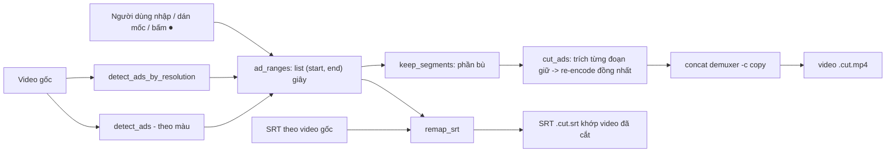

# Tính năng dò & cắt quảng cáo chèn giữa video — kiến trúc, thuật toán, mã nguồn

Tài liệu này mô tả đầy đủ tính năng "lọc và cắt đoạn quảng cáo" trong **vtool**: bài toán, kiến trúc,
thuật toán từng bước, tham số, các lỗi đã gặp khi chạy thật, cách tích hợp, cách mang sang dự án khác,
và **toàn bộ mã nguồn** liên quan (ở Phụ lục).

---

## 1. Bài toán

Các video phim reup (thường 1–2.5 tiếng) có **quảng cáo chèn giữa**, ví dụ quảng cáo cờ bạc ~26–28 giây
xuất hiện 3–7 lần. Cần:

1. **Tìm** các đoạn quảng cáo (tự động, hoặc người dùng tự nhập mốc).
2. **Cắt** bỏ chúng, nối các đoạn phim còn lại thành một file liền mạch, không mất khung hình, không lệch tiếng.
3. **Dời giờ phụ đề** (SRT) đã làm theo video gốc cho khớp với video đã cắt.

Hai đặc điểm của dữ liệu thực tế quyết định thiết kế:

- Quảng cáo thường có **độ phân giải khác phim**: phim 1280×720, quảng cáo 1920×1080. Đây là dấu hiệu gần như
  tuyệt đối. Nhưng không phải video nào cũng vậy (có tập quảng cáo cùng 720p với phim).
- Quảng cáo cờ bạc có **màu đỏ/vàng bão hoà rất mạnh** và kéo dài liên tục, trong khi phim hiếm khi có cảnh
  đỏ/vàng rực kéo dài > 12 giây.

---

## 2. Kiến trúc

```
vtool/vtool/
├── ads.py            ← LÕI: dò (2 cách) + tính đoạn giữ + cắt/nối + dời giờ SRT
├── ffmpeg_util.py    ← chạy ffmpeg, đo thời lượng, chọn encoder GPU, thanh % theo -progress
├── progress.py       ← thanh tiến độ (TTY vẽ tại chỗ; log thì in mốc % thưa + ETA)
├── pipeline.py       ← dùng ads khi chạy `vtool do ... --cut-ads` (cắt trước khi dịch/lồng tiếng)
├── cli.py            ← cờ --cut-ads
├── studio.py         ← backend trang Studio: job nền detect/cut, bắt % từ stdout, chế độ "chạy mát"
├── gui.py            ← HTTP server: route /studio, /api/studio/*, /media/<id> (stream có Range)
└── web/studio.html   ← giao diện tab "Cắt quảng cáo"
```

### Luồng dữ liệu



### Phân lớp

| Lớp | File | Vai trò | Phụ thuộc |
|---|---|---|---|
| Lõi thuật toán | `ads.py` | hàm thuần, nhận đường dẫn + số giây, trả list/file | `ffmpeg_util`, `progress`, `av`, `numpy` |
| Tiện ích media | `ffmpeg_util.py` | gọi ffmpeg, đo duration, chọn encoder | `imageio-ffmpeg`, `av` |
| Tiến độ | `progress.py` | `Bar` | không |
| Điều phối CLI | `pipeline.py`, `cli.py` | cắt ad như 1 bước trong pipeline dịch/lồng tiếng | `ads` |
| Web backend | `studio.py`, `gui.py` | job nền, trạng thái, stream video, bảo vệ API | `ads`, `http.server` |
| Web frontend | `web/studio.html` | nhập/sửa mốc, timeline, xem thử, gọi API | trình duyệt |

`ads.py` không biết gì về web hay CLI: mọi lớp trên chỉ gọi 5 hàm công khai của nó.

---

## 3. Thuật toán chi tiết

### 3.1 Dò theo độ phân giải — `detect_ads_by_resolution` (khuyên dùng)

Ý tưởng: kích thước khung hình **phổ biến nhất** chính là phim; mọi mẫu có kích thước khác là quảng cáo.

1. **Lấy mẫu** mỗi `step = 2.0` giây: mở container bằng PyAV, `seek(t, backward=True)` tới keyframe trước `t`,
   giải mã 1 khung, đọc `(width, height)`.
2. **Kích thước chính** = mode (giá trị xuất hiện nhiều nhất) của tất cả mẫu (`Counter.most_common(1)`).
3. **Hits** = các thời điểm có kích thước ≠ kích thước chính.
4. **Gộp** các hit liền nhau: 2 hit cách nhau ≤ `2 × step` thuộc cùng một đoạn → được các khoảng thô `[s, p]`.
5. **Tinh chỉnh biên ở độ phân giải 0.2 s**:
   - Đầu đoạn: từ `s` lùi dần 0.2 s cho tới khi gặp khung có kích thước chính (tối đa `step + 0.2` s)
     → biên đầu `a2 = t_gặp + 0.2`.
   - Cuối đoạn: từ `p` tiến dần 0.2 s cho tới khi gặp khung kích thước chính → `b2 = t_gặp − 0.2`.
6. **Đệm vào phía phim** `pad = 0.3` s: `(a2 − 0.3, b2 + 0.3)`, kẹp trong `[0, dur]`.
   Mục đích: đảm bảo **không còn sót khung 1080p nào** ở đoạn giữ lại (seek theo keyframe nên biên có sai số),
   đổi lại mất tối đa ~0.3 s phim mỗi bên — không nhận thấy khi xem.

Độ phức tạp: `dur/step` lần mở file + seek + decode 1 khung (mỗi lần mở lại container để seek độc lập).
Thực tế: video 2 giờ ≈ 3–5 phút, CPU nhẹ (1 luồng).

Ưu điểm: không có dương tính giả do nội dung (cảnh lửa, mưa, màu sắc...). Nhược điểm: vô dụng khi quảng cáo
cùng độ phân giải với phim → dùng 3.2.

### 3.2 Dò theo màu — `detect_ads` (dự phòng)

Nhắm vào quảng cáo cờ bạc: nền đỏ/vàng bão hoà, sáng, kéo dài.

1. **Lấy mẫu** mỗi 2 s, giải mã 1 khung, chuyển RGB, **lấy thưa 1/4 mỗi chiều** (`[::4, ::4]`) → nhanh ×16.
2. **Chấm điểm khung** — `_ad_score(img)`:
   - Độ bão hoà kiểu HSV: `sat = (max − min) / max` theo từng điểm ảnh.
   - Mặt nạ **đỏ**: `R > 120 và R > 1.25·G và R > 1.3·B`.
   - Mặt nạ **vàng/kim**: `R > 150 và G > 110 và B < 0.7·G`.
   - `adpx` = % điểm ảnh thuộc (đỏ ∪ vàng) **và** `sat > 0.35`.
   - `meanR` = trung bình kênh R (độ "rực đỏ" tổng thể).
3. **Hit** khi `adpx > thr_pct (30%)` **và** `meanR > thr_r (110)`.
4. **Gộp** hit cách nhau ≤ `merge_gap = 6` s → khoảng `[s, p + step]`.
5. **Lọc độ dài**: bỏ khoảng ngắn hơn `min_dur = 12` s — cảnh lửa/máu/đèn lồng trong phim chỉ loé vài giây,
   còn quảng cáo kéo dài 14–30 s.
6. **Đệm ra ngoài** `pad = 1` s mỗi bên (ngược với 3.1: ở đây biên thô nên nới rộng để không sót quảng cáo).

Độ tin cậy thấp hơn 3.1: trong thực tế, 1 tập 2h41 dò theo màu ra 7 đoạn, trong đó 3 đoạn trùng với dò theo
độ phân giải, 4 đoạn còn lại chưa xác nhận được. **Luôn cho người xem xác nhận trước khi cắt.**

### 3.3 Đoạn giữ lại — `keep_segments`

Phần bù của các đoạn quảng cáo trên `[0, dur]`, xử lý được đoạn chồng lấn/không sắp xếp:

```
cur = 0
với mỗi (a, b) đã sort:
    nếu a > cur: giữ (cur, a)
    cur = max(cur, b)
nếu cur < dur: giữ (cur, dur)
bỏ các đoạn dài ≤ 0.05 s
```

### 3.4 Cắt & nối — `cut_ads`

Cách làm cuối cùng (sau nhiều lần thử hỏng, xem mục 5):

1. Đọc `fps`, `W×H` của **luồng video chính** (PyAV). Đây là chuẩn chung cho mọi đoạn.
2. Với **từng** đoạn giữ `(a, b)` chạy **một lệnh ffmpeg riêng**:
   ```
   ffmpeg -ss a -t (b−a) -i input
          -vf scale=W:H:force_original_aspect_ratio=decrease,pad=W:H:(ow-iw)/2:(oh-ih)/2,setsar=1,fps=FPS
          -fps_mode cfr -c:a aac -ar 48000  <encoder GPU/CPU, quality>  segNNN.mp4
   ```
   - `-ss` đặt **trước** `-i` = fast seek (nhảy thẳng tới vị trí), khi re-encode thì vẫn **chính xác tới khung**.
   - `scale+pad+setsar+fps` + `-fps_mode cfr` + audio `aac 48 kHz`: mọi đoạn có **cùng** độ phân giải, tỉ lệ,
     fps, định dạng âm thanh → nối bằng copy được.
   - Encoder chọn tự động: NVENC > QSV > AMF > libx264 (`video_encoder_args(quality, pix_fmt=None)`).
3. Ghi `list.txt` (`file '.../seg000.mp4'` mỗi dòng) rồi **nối bằng concat demuxer**:
   `ffmpeg -f concat -safe 0 -i list.txt -c copy -movflags +faststart out.mp4` (không encode lại).
4. Xoá thư mục tạm `<out>_segs/` trong `finally` (kể cả khi lỗi).

Tốc độ: QSV ≈ 16× thời gian thực (2 giờ phim ≈ 8–10 phút).

**Chất lượng (`quality`)**: số nhỏ = nét hơn + file to hơn. Nếu file cắt chỉ là **trung gian** (sau đó còn burn
phụ đề, tức encode lại lần nữa) thì dùng 26–28 để đỡ tốn ổ; nếu là file cuối thì 20–23.

### 3.5 Dời giờ phụ đề — `remap_srt`

Với mỗi mốc thời gian `t` của một câu:

```
removed = tổng (b − a) của các đoạn ad nằm HOÀN TOÀN trước t   (b ≤ t)
nếu t rơi vào trong một đoạn ad (a ≤ t < b): câu bị bỏ
t_mới = t − removed
```

Áp cho cả `start` và `end`; bỏ câu nếu một trong hai rơi vào ad, hoặc `end_mới ≤ start_mới`.

Lưu ý: vì đoạn cắt được đệm (3.1 pad 0.3 s / 3.2 pad 1 s), câu sát biên quảng cáo có thể bị bỏ oan
nếu nó chạm vùng đệm. Thực tế hiếm vì quảng cáo thường chèn giữa hai cảnh.

### 3.6 Đọc mốc thời gian người dùng nhập — `parseT` (frontend)

Nhận các dạng:

| Nhập | Hiểu là |
|---|---|
| `325.5` | 325.5 giây |
| `05:25.5` | mm:ss |
| `1:05:25.5` hoặc `1:05:25,5` | hh:mm:ss (dấu phẩy thập phân kiểu SRT) |
| `00:05:00:19` | **timecode** hh:mm:ss:khung → `+ khung / fps` |

`fps` của timecode lấy từ ô "FPS của timecode" (mặc định = fps video). **Lưu ý**: phần mềm dựng có thể đặt
timeline khác fps video (đã gặp mốc `:30` trên video 25 fps) → khi đó phải chỉnh ô này, hoặc tốt hơn: dùng
dò theo độ phân giải để lấy biên chính xác.

Dán hàng loạt: mỗi dòng khớp regex `([\d:.,]+)\s*(-|–|—|->|→|khoảng trắng)\s*([\d:.,]+)`; dòng rác bị bỏ qua.

### 3.7 Xem thử trước khi cắt (frontend)

- **Timeline**: thanh ngang, mỗi đoạn ad là một khối đỏ `left = a/dur`, `width = (b−a)/dur`; bấm để tua.
- **"Xem như đã cắt"**: trong `timeupdate`, nếu `a ≤ t < b − 0.05` thì nhảy `currentTime = b` → xem đúng
  chỗ nối như sau khi cắt, không phải encode.
- **⏺**: gán biên = `currentTime` của video đang xem. **▶ đầu / ▶ cuối**: tua tới `a − 3 s` / `b − 1 s`.

---

## 4. Tham số mặc định

| Hàm | Tham số | Mặc định | Ý nghĩa |
|---|---|---|---|
| `detect_ads_by_resolution` | `step` | 2.0 | khoảng lấy mẫu (giây) |
| | `pad` | 0.3 | đệm vào phía phim để chắc chắn bỏ hết khung khác res |
| `detect_ads` | `step` | 2.0 | khoảng lấy mẫu |
| | `thr_pct` | 30 | % điểm ảnh đỏ/vàng bão hoà tối thiểu |
| | `thr_r` | 110 | trung bình kênh R tối thiểu |
| | `merge_gap` | 6 | gộp hit cách nhau ≤ 6 s |
| | `pad` | 1.0 | đệm ra ngoài mỗi bên |
| | `min_dur` | 12 | bỏ đoạn ngắn hơn 12 s |
| `cut_ads` | `quality` | 20 | CQ/CRF encoder (Studio dùng 23; pipeline trước burn dùng 28) |
| Studio | "Chạy mát" | bật | đặt trần CPU 99% (tắt turbo) trong lúc chạy, trả 100% khi xong |

---

## 5. Lỗi đã gặp khi chạy thật & cách xử lý (quan trọng khi port)

| # | Hiện tượng | Nguyên nhân | Cách xử lý đang dùng |
|---|---|---|---|
| 1 | QSV báo lỗi `-40` sau concat filter | `h264_qsv` không nhận khung có fps/định dạng thay đổi | bỏ concat filter (xem #3); nếu có filter thì kết thúc bằng `fps=…,format=nv12` + `-fps_mode cfr` |
| 2 | QSV lỗi `-22` "Invalid argument" | ép `-pix_fmt yuv420p` trong khi filter xuất `nv12` | `video_encoder_args(pix_fmt=None)` + `filter_format()` (HW → nv12, CPU → yuv420p) đặt ở CUỐI filter |
| 3 | Nối bằng concat **filter** (split→trim→concat) bị nuốt đoạn / lệch PTS | nguồn đổi độ phân giải giữa chừng (720p↔1080p) làm filter graph reconfig | **trích từng đoạn bằng lệnh ffmpeg riêng + concat demuxer** (cách hiện tại) |
| 4 | Stream copy từng đoạn (`-c copy`) → lệch vài giây | `-ss` với copy nhảy về keyframe gần nhất → biên sai tới cả GOP | luôn **re-encode** từng đoạn |
| 5 | Hết ổ (`No space left on device`, mã -28) | đoạn re-encode ở quality 20 phình gần 2× gốc (1.3 GB → 2.4 GB), cộng file nối = cần ~2× | quality 26–28 cho file trung gian; kiểm tra dung lượng trống ≥ 2–3× file gốc |
| 6 | Lỗi ffmpeg bị nuốt, chỉ thấy `CalledProcessError` | stderr không được in | `run_progress` raise `RuntimeError` kèm 6 dòng cuối stderr |
| 7 | Mốc người dùng gõ tay sai (ghi 2:00:01, thực tế 2:00:53.9) | nhầm khi xem/ghi | luôn đối chiếu bằng `detect_ads_by_resolution` hoặc bấm "▶ đầu" xem lại |
| 8 | Dò theo màu bắt nhầm cảnh phim | cảnh lửa/đỏ dài | `min_dur = 12`, và người dùng duyệt lại trên timeline |
| 9 | Máy lên 90 °C khi encode | turbo CPU | "Chạy mát": `powercfg PROCTHROTTLEMAX 99` (tắt turbo, vẫn đủ core) → ~65–75 °C |
| 10 | Giữ thư mục tạm `_segs` khi tiến trình bị giết giữa chừng | `finally` không chạy khi process bị kill | xoá tay `<tên>_segs/` trước khi chạy lại |

---

## 6. Tích hợp trong vtool

### 6.1 Python

```python
from vtool import ads

ranges = ads.detect_ads_by_resolution("phim.mp4")          # [(300.5, 327.1), ...]
# hoặc ranges = ads.detect_ads("phim.mp4")                 # theo màu
# hoặc ranges = [(300.5, 327.1), (2427.9, 2454.3)]          # tự nhập
ads.cut_ads("phim.mp4", ranges, "phim.cut.mp4", quality=23)

from vtool.srt_read import read_srt
from vtool.subtitle import write_srt
write_srt(ads.remap_srt(read_srt("phim.zh.srt"), ranges), "phim.cut.zh.srt")
```

### 6.2 CLI

```
vtool do phim.mp4 --srt phim.zh.srt --cut-ads --to vi --dub --burn
```
`--cut-ads` dò **theo màu** rồi cắt trước khi dịch/lồng tiếng (pipeline tự `remap_srt`).
Muốn dùng mốc đã xác nhận: gọi `pipeline.process(..., ad_ranges=[(a, b), ...])`.

### 6.3 Web (Studio)

`vtool gui` → `http://127.0.0.1:8790/studio` → tab **Cắt quảng cáo**.

| Method | Route | Body | Trả về |
|---|---|---|---|
| POST | `/api/studio/open` | `{path}` | `{media: {id, url, duration, fps, width, height, warn?}}` |
| POST | `/api/studio/detect` | `{video, method: "resolution"\|"color"}` | `{ok}` → kết quả ở status `result.ranges` |
| POST | `/api/studio/cut` | `{video, ranges, srt?, quality, delete_src, cool}` | `{ok}` → `result.output`, `result.srt` |
| GET | `/api/studio/status` | – | `{running, label, progress, status, logs, error, result}` |
| GET | `/media/<id>` | Range | stream video (206) |

**Bảo mật**: server chỉ bind `127.0.0.1`. Mọi POST `/api/studio/*` bắt buộc `Host` là
`127.0.0.1:<port>`/`localhost:<port>` **và** header `X-Vtool: 1`. Header tuỳ biến buộc trình duyệt gửi
preflight CORS mà server không trả lời → trang web lạ không gọi được API đọc/ghi/xoá file. Video chỉ stream
được qua id đã `open` (không nhận đường dẫn tuỳ ý qua URL).

**Tiến độ**: job chạy trong thread; `sys.stdout` được thay bằng `_Tee` để bắt các dòng `"<nhãn> NN%"` do
`Bar` in ra (ở chế độ không phải TTY) → `JOB.progress`; các dòng khác vào `JOB.logs`. Frontend poll
`/api/studio/status` mỗi giây.

---

## 7. Mang sang dự án khác

1. Copy `ads.py`, `ffmpeg_util.py`, `progress.py` vào cùng một package.
2. Cài: `pip install av numpy imageio-ffmpeg` (ffmpeg được `imageio-ffmpeg` tải sẵn, không cần cài riêng;
   bản này **không có ffprobe** nên mọi thông tin media đọc qua PyAV).
3. Nếu dự án không dùng package (import tương đối `from .ffmpeg_util ...`), đổi thành import tuyệt đối.
4. Nếu dự án có sẵn ffmpeg hệ thống: sửa `ffmpeg_exe()` trả `"ffmpeg"`.
5. Máy không có GPU: `best_h264()` tự rơi về `libx264`; ép CPU bằng biến môi trường `VTOOL_FORCE_CPU=1`.
6. `remap_srt` chỉ cần list dict `{"start": giây, "end": giây, "text": ...}` — không phụ thuộc định dạng SRT.

### Hướng cải tiến (chưa làm)

- `detect_ads_by_resolution` mở lại container mỗi mẫu → có thể giải mã tuần tự 1 lần (nhanh hơn nhiều),
  hoặc đọc `codec_context` theo packet thay vì decode.
- Dò bằng **âm thanh** (loudness nhảy vọt, nhạc quảng cáo) hoặc **khớp mẫu** (quảng cáo lặp lại y hệt
  nhiều lần trong 1 tập → so khớp fingerprint khung/âm thanh giữa các lần).
- **Smart cut**: chỉ re-encode vài giây quanh biên, phần giữa copy nguyên GOP → gần như không mất chất lượng
  và nhanh hơn rất nhiều so với re-encode toàn bộ.
- Tuỳ chọn pad = 0 khi đã tinh chỉnh biên bằng khung (decode tuần tự quanh biên thay vì seek).

---

## Phụ lục A — `vtool/ads.py` (toàn bộ)

```python
"""Dò & cắt đoạn quảng cáo chèn giữa video (vd quảng cáo cờ bạc nền đỏ/vàng bão hoà).

Cách dò: lấy mẫu 1 khung mỗi `step` giây, tính tỉ lệ điểm ảnh "đỏ/vàng bão hoà" và độ sáng đỏ.
Quảng cáo cờ bạc rất khác nội dung phim (thường tối, ít bão hoà) nên tách được bằng ngưỡng màu.
KHÔNG chắc chắn 100% -> luôn cho người xem xác nhận khoảng thời gian trước khi cắt.
"""
from __future__ import annotations
from pathlib import Path

from .ffmpeg_util import run, duration
from .progress import Bar


def _ad_score(img) -> tuple[float, float]:
    """img: numpy HxWx3 (RGB). Trả (tỉ lệ điểm ảnh ad, độ sáng đỏ trung bình)."""
    import numpy as np
    a = img.reshape(-1, 3).astype(float)
    R, G, B = a[:, 0], a[:, 1], a[:, 2]
    mx = a.max(1); mn = a.min(1)
    sat = np.where(mx > 0, (mx - mn) / np.maximum(mx, 1), 0)
    red = (R > 120) & (R > G * 1.25) & (R > B * 1.3)
    gold = (R > 150) & (G > 110) & (B < G * 0.7)
    adpx = ((red | gold) & (sat > 0.35)).mean() * 100
    return float(adpx), float(R.mean())


def detect_ads(video: str | Path, step: float = 2.0, thr_pct: float = 30.0,
               thr_r: float = 110.0, merge_gap: float = 6.0, pad: float = 1.0,
               min_dur: float = 12.0, log=print) -> list[tuple[float, float]]:
    """Quét video, trả danh sách (start, end) giây của các đoạn nghi là quảng cáo.

    Chỉ giữ đoạn dài >= min_dur giây: quảng cáo thường dài (vd 28s), còn cảnh lửa/đỏ trong phim
    chỉ loé vài giây -> lọc bớt dương tính giả.
    """
    import av
    path = str(Path(video).resolve())
    dur = duration(path)
    container = av.open(path)
    vs = container.streams.video[0]
    tb = vs.time_base
    hits: list[float] = []
    n = int(dur / step) + 1
    bar = Bar(n or 1, label="dò ad")
    i = 0
    t = 0.0
    while t < dur:
        try:
            container.seek(int(t / tb), stream=vs, backward=True)
            frame = next(container.decode(vs), None)
        except Exception:
            frame = None
        if frame is not None:
            img = frame.to_ndarray(format="rgb24")[::4, ::4, :]
            adpx, meanr = _ad_score(img)
            if adpx > thr_pct and meanr > thr_r:
                hits.append(round(t, 2))
        i += 1
        bar.update(i, f"{i}/{n}")
        t += step
    bar.finish()
    container.close()

    if not hits:
        return []
    # Gộp các mốc liền nhau (cách nhau <= merge_gap) thành khoảng
    ranges: list[list[float]] = []
    s = p = hits[0]
    for x in hits[1:]:
        if x - p <= merge_gap:
            p = x
        else:
            ranges.append([s, p + step])
            s = p = x
    ranges.append([s, p + step])
    # Lọc theo độ dài tối thiểu (bỏ loé lửa/đỏ ngắn) + đệm mép + kẹp biên
    out: list[tuple[float, float]] = []
    for a, b in ranges:
        if (b - a) < min_dur:
            continue
        a = max(0.0, a - pad)
        b = min(dur, b + pad)
        out.append((round(a, 2), round(b, 2)))
    return out


def detect_ads_by_resolution(video: str | Path, step: float = 2.0, pad: float = 0.3,
                             log=print) -> list[tuple[float, float]]:
    """Dò quảng cáo theo ĐỘ PHÂN GIẢI: nội dung thường 1 kích thước cố định, quảng cáo chèn vào
    hay khác kích thước (vd phim 1280x720, quảng cáo 1920x1080). Rất chuẩn khi ad khác res —
    không dính dương tính giả kiểu cảnh lửa/đỏ. Tự tinh chỉnh biên ở mức 0.2s và đệm `pad` vào
    content để cắt TRỌN vùng khác-res (đoạn giữ lại đồng nhất -> concat không mất frame)."""
    import av
    from collections import Counter
    path = str(Path(video).resolve())
    dur = duration(path)

    def dims(t: float):
        c = av.open(path); vs = c.streams.video[0]; tb = vs.time_base
        try:
            c.seek(int(t / tb), stream=vs, backward=True)
            f = next(c.decode(vs), None)
            return (f.width, f.height) if f else None
        finally:
            c.close()

    # kích thước phổ biến nhất = nội dung
    samples = []
    t = 0.0
    bar = Bar(int(dur / step) + 1 or 1, label="dò res")
    i = 0
    while t < dur:
        d = dims(t)
        if d:
            samples.append((round(t, 2), d))
        i += 1; bar.update(i, f"{i}")
        t += step
    bar.finish()
    if not samples:
        return []
    main = Counter(d for _, d in samples).most_common(1)[0][0]
    hits = [tt for tt, d in samples if d != main]
    if not hits:
        return []
    # gộp
    ranges = []
    s = p = hits[0]
    for x in hits[1:]:
        if x - p <= step * 2:
            p = x
        else:
            ranges.append([s, p]); s = p = x
    ranges.append([s, p])

    def is_main(t):
        return dims(t) == main

    out = []
    for a, b in ranges:
        # tinh chỉnh start lùi, end tiến ở mức 0.2s
        tt = a
        while tt > a - step - 0.2 and tt > 0 and not is_main(tt):
            tt -= 0.2
        a2 = tt + 0.2
        tt = b
        while tt < b + step + 0.2 and tt < dur and not is_main(tt):
            tt += 0.2
        b2 = tt - 0.2
        out.append((round(max(0.0, a2 - pad), 2), round(min(dur, b2 + pad), 2)))
    return out


def keep_segments(ad_ranges: list[tuple[float, float]], dur: float) -> list[tuple[float, float]]:
    """Phần bù của các đoạn ad -> các đoạn GIỮ LẠI."""
    keep: list[tuple[float, float]] = []
    cur = 0.0
    for a, b in sorted(ad_ranges):
        if a > cur:
            keep.append((cur, a))
        cur = max(cur, b)
    if cur < dur:
        keep.append((cur, dur))
    return [(a, b) for a, b in keep if b - a > 0.05]


def remap_srt(segments: list[dict], ad_ranges: list[tuple[float, float]]) -> list[dict]:
    """Bỏ cue nằm trong đoạn ad, dời cue còn lại sớm lại theo tổng thời lượng đã cắt trước nó."""
    ads = sorted(ad_ranges)

    def shift(t: float) -> float | None:
        removed = 0.0
        for a, b in ads:
            if a <= t < b:
                return None            # cue nằm trong ad -> bỏ
            if b <= t:
                removed += (b - a)
        return t - removed

    out: list[dict] = []
    for s in segments:
        ns, ne = shift(s["start"]), shift(s["end"])
        if ns is None or ne is None or ne <= ns:
            continue
        out.append(dict(s, start=ns, end=ne))
    return out


def cut_ads(video: str | Path, ad_ranges: list[tuple[float, float]], out: str | Path,
            reencode: bool = True, quality: int = 20, log=print) -> str:
    """Xuất video đã bỏ các đoạn ad (nối các đoạn giữ lại).

    Cách làm: trích TỪNG đoạn giữ bằng ffmpeg riêng (fast-seek `-ss/-t`, re-encode, scale đồng nhất),
    rồi nối bằng concat DEMUXER (stream copy). Bền với video ĐỔI ĐỘ PHÂN GIẢI giữa chừng (phim 720p,
    quảng cáo 1080p): dùng concat FILTER hay bị lỗi reconfig/nuốt đoạn; fast-seek thì scale chỉ thấy
    phần đã seek tới nên sạch và nhanh (~16x).
    """
    import os
    import shutil
    from .ffmpeg_util import video_encoder_args, run_progress, run, ffmpeg_exe
    path = str(Path(video).resolve())
    dur = duration(path)
    keep = keep_segments(ad_ranges, dur)
    if not keep:
        raise ValueError("Không còn đoạn nào để giữ.")
    # fps + kích thước nguồn (chuẩn hoá mọi đoạn về đây để concat copy được)
    fps = 25.0
    W, H = 1280, 720
    try:
        import av
        c = av.open(path)
        vstream = c.streams.video[0]
        r = vstream.average_rate
        if r:
            fps = float(r)
        W = vstream.codec_context.width or W
        H = vstream.codec_context.height or H
        c.close()
    except Exception:
        pass
    n = len(keep)
    total_keep = sum(b - a for a, b in keep)
    log(f"[ad] giữ {n} đoạn, tổng {total_keep:.0f}s (cắt {dur-total_keep:.0f}s)")
    tmpdir = Path(out).parent / (Path(out).stem + "_segs")
    tmpdir.mkdir(parents=True, exist_ok=True)
    seg_files: list[Path] = []
    vf = (f"scale={W}:{H}:force_original_aspect_ratio=decrease,"
          f"pad={W}:{H}:(ow-iw)/2:(oh-ih)/2,setsar=1,fps={fps:g}")
    try:
        for i, (a, b) in enumerate(keep):
            segout = tmpdir / f"seg{i:03d}.mp4"
            run_progress(["-ss", f"{a}", "-t", f"{b - a}", "-i", path, "-vf", vf,
                          "-fps_mode", "cfr", "-c:a", "aac", "-ar", "48000",
                          *video_encoder_args(quality, pix_fmt=None), str(segout)],
                         total_dur=(b - a), label=f"cắt {i+1}/{n}")
            seg_files.append(segout)
        # nối bằng concat demuxer (stream copy)
        listfile = tmpdir / "list.txt"
        listfile.write_text(
            "".join(f"file '{p.as_posix()}'\n" for p in seg_files), encoding="utf-8")
        log(f"[ad] nối {n} đoạn...")
        run(["-f", "concat", "-safe", "0", "-i", str(listfile), "-c", "copy",
             "-movflags", "+faststart", str(out)])
    finally:
        try:
            shutil.rmtree(tmpdir, ignore_errors=True)
        except Exception:
            pass
    return str(out)
```

> Ghi chú: tham số `reencode` hiện không dùng (luôn re-encode, xem lỗi #4); `import os`, `ffmpeg_exe` trong
> `cut_ads` là thừa, giữ nguyên để khớp mã hiện tại.

---

## Phụ lục B — `vtool/ffmpeg_util.py` (toàn bộ)

```python
"""Tiện ích ffmpeg — lấy binary từ imageio-ffmpeg (không cần cài tay), chạy lệnh, đo thời lượng."""
from __future__ import annotations
import subprocess
import shutil
from pathlib import Path
from functools import lru_cache


@lru_cache(maxsize=1)
def ffmpeg_exe() -> str:
    import imageio_ffmpeg
    return imageio_ffmpeg.get_ffmpeg_exe()


@lru_cache(maxsize=1)
def ytdlp_ffmpeg() -> str:
    """yt-dlp cần file tên đúng 'ffmpeg.exe' để ghép video+audio; imageio đặt tên khác.
    Tạo 1 bản sao 'ffmpeg.exe' cạnh binary gốc (1 lần) rồi trả đường dẫn đó."""
    src = ffmpeg_exe()
    dst = Path(src).with_name("ffmpeg.exe")
    if dst.exists():
        return str(dst)
    try:
        shutil.copy2(src, dst)
        return str(dst)
    except Exception:
        return src


def run(args: list[str], capture: bool = False) -> subprocess.CompletedProcess:
    """Chạy ffmpeg với cờ mặc định gọn (ẩn banner, chỉ báo lỗi, tự ghi đè)."""
    cmd = [ffmpeg_exe(), "-hide_banner", "-loglevel", "error", "-y", *args]
    return subprocess.run(
        cmd, check=True,
        stdout=(subprocess.PIPE if capture else None),
        stderr=(subprocess.PIPE if capture else None),
        text=True,
    )


def _parse_ff_time(ts: str) -> float:
    """'00:01:23.456789' -> giây."""
    try:
        h, m, s = ts.split(":")
        return int(h) * 3600 + int(m) * 60 + float(s)
    except Exception:
        return 0.0


def run_progress(args: list[str], total_dur: float = 0.0, label: str = "ffmpeg",
                 stream=None) -> int:
    """Như run() nhưng vẽ thanh % theo tiến độ encode (out_time so với total_dur giây).

    total_dur <= 0 -> không biết thời lượng, chạy như run() thường (không có bar).
    """
    if not total_dur or total_dur <= 0:
        run(args)
        return 0
    from .progress import Bar
    cmd = [ffmpeg_exe(), "-hide_banner", "-loglevel", "error", "-y",
           "-progress", "pipe:1", "-nostats", *args]
    bar = Bar(total_dur, label=label, stream=stream, step=2)
    p = subprocess.Popen(cmd, stdout=subprocess.PIPE, stderr=subprocess.PIPE,
                         text=True, bufsize=1)
    try:
        for line in p.stdout:
            line = line.strip()
            if line.startswith("out_time="):
                sec = _parse_ff_time(line.split("=", 1)[1])
                bar.update(sec, f"{sec:.0f}/{total_dur:.0f}s")
            elif line == "progress=end":
                bar.update(total_dur, f"{total_dur:.0f}/{total_dur:.0f}s")
                break
        err = p.stderr.read() if p.stderr else ""
    finally:
        ret = p.wait()
    bar.finish()
    if ret != 0:
        tail = "\n".join((err or "").strip().splitlines()[-6:])
        raise RuntimeError(f"ffmpeg lỗi (mã {ret}):\n{tail}")
    return ret


def duration(path: str | Path) -> float:
    """Thời lượng (giây). Ưu tiên PyAV (đi kèm faster-whisper), fallback đọc stderr ffmpeg."""
    path = str(path)
    try:
        import av
        with av.open(path) as c:
            if c.duration is not None:
                return float(c.duration) / av.time_base
            for s in c.streams:
                if s.duration and s.time_base:
                    return float(s.duration * s.time_base)
    except Exception:
        pass
    try:
        p = subprocess.run(
            [ffmpeg_exe(), "-i", path], stderr=subprocess.PIPE, text=True
        )
        for line in p.stderr.splitlines():
            line = line.strip()
            if line.startswith("Duration:"):
                hms = line.split("Duration:")[1].split(",")[0].strip()
                h, m, s = hms.split(":")
                return int(h) * 3600 + int(m) * 60 + float(s)
    except Exception:
        pass
    return 0.0


def has_audio(path: str | Path) -> bool:
    try:
        import av
        with av.open(str(path)) as c:
            return any(s.type == "audio" for s in c.streams)
    except Exception:
        return True  # nghi ngờ -> coi như có, để pipeline tự xử


def _test_encoder(enc: str) -> bool:
    try:
        r = subprocess.run(
            [ffmpeg_exe(), "-hide_banner", "-loglevel", "error", "-y",
             "-f", "lavfi", "-i", "color=s=64x64:d=0.1", "-c:v", enc, "-f", "null", "-"],
            stdout=subprocess.DEVNULL, stderr=subprocess.DEVNULL, timeout=25)
        return r.returncode == 0
    except Exception:
        return False


@lru_cache(maxsize=1)
def best_h264() -> str:
    """Encoder H.264 tốt nhất máy có: NVENC (NVIDIA) > QSV (Intel) > AMF (AMD) > libx264 (CPU)."""
    import os
    if os.environ.get("VTOOL_FORCE_CPU"):
        return "libx264"
    for enc in ("h264_nvenc", "h264_qsv", "h264_amf"):
        if _test_encoder(enc):
            return enc
    return "libx264"


def video_encoder_args(quality: int = 22, pix_fmt: str | None = "yuv420p") -> list[str]:
    """Cờ encode video theo encoder tốt nhất (tự dùng GPU nếu có). quality: nhỏ = nét hơn.

    pix_fmt=None: KHÔNG ép -pix_fmt (dùng khi đã đặt định dạng trong filter, tránh xung đột với QSV).
    """
    enc = best_h264()
    if enc == "h264_nvenc":
        args = ["-c:v", "h264_nvenc", "-preset", "p4", "-cq", str(quality)]
    elif enc == "h264_qsv":
        args = ["-c:v", "h264_qsv", "-global_quality", str(quality)]
    elif enc == "h264_amf":
        args = ["-c:v", "h264_amf", "-rc", "cqp", "-qp_i", str(quality), "-qp_p", str(quality)]
    else:
        args = ["-c:v", "libx264", "-preset", "medium", "-crf", str(quality)]
    return args + (["-pix_fmt", pix_fmt] if pix_fmt else [])


def filter_format() -> str:
    """Định dạng pixel nên đặt ở CUỐI filter chain cho encoder hiện tại.

    QSV/NVENC/AMF nhận nv12 (định dạng gốc HW) -> tránh lỗi -22/-40 khi qua concat/overlay.
    libx264 dùng yuv420p cho tương thích rộng.
    """
    return "nv12" if best_h264() in ("h264_qsv", "h264_nvenc", "h264_amf") else "yuv420p"
```

---

## Phụ lục C — `vtool/progress.py` (toàn bộ)

```python
"""Thanh tiến trình gọn, không thêm dependency.

- Terminal thật (TTY): vẽ 1 dòng cập nhật tại chỗ bằng '\\r'  ->  giọng [████████░░░░] 62% 74/120  ETA 0:48
- Khi ghi log/redirect (không TTY): in mốc % thưa (mặc định mỗi ~2%) kèm ETA để không spam mà vẫn theo dõi được.
"""
from __future__ import annotations
import sys
import time


def _fmt_time(s: float) -> str:
    s = int(max(0, s))
    if s >= 3600:
        return f"{s // 3600:d}:{(s % 3600) // 60:02d}:{s % 60:02d}"
    return f"{s // 60:d}:{s % 60:02d}"


class Bar:
    def __init__(self, total: float, label: str = "", width: int = 24, stream=None, step: int = 2):
        self.total = max(1e-9, float(total))
        self.label = label
        self.width = width
        self.s = stream or sys.stdout
        self.tty = bool(getattr(self.s, "isatty", lambda: False)())
        self.step = max(1, int(step))      # non-TTY: in khi % tăng >= step
        self.start = time.time()
        self._last_pct = -1
        self._closed = False

    def _eta(self, current: float) -> str:
        el = time.time() - self.start
        if current <= 0 or el < 0.5:
            return ""
        rate = current / el
        if rate <= 0:
            return ""
        rem = (self.total - current) / rate
        if rem <= 0:
            return ""
        return f"  ETA {_fmt_time(rem)}"

    def update(self, current: float, suffix: str = ""):
        pct = max(0, min(100, int(current * 100 / self.total)))
        eta = self._eta(current)
        if self.tty:
            fill = int(self.width * pct / 100)
            barstr = "█" * fill + "░" * (self.width - fill)
            self.s.write(f"\r  {self.label:<7}[{barstr}] {pct:3d}%  {suffix}{eta}   ")
            self.s.flush()
        elif pct >= self._last_pct + self.step:
            self._last_pct = pct
            self.s.write(f"  {self.label} {pct}%  {suffix}{eta}\n")
            self.s.flush()

    def finish(self, msg: str = ""):
        if self._closed:
            return
        self._closed = True
        if self.tty:
            self.s.write("\r" + " " * (self.width + 56) + "\r")
            self.s.flush()
        if msg:
            self.s.write(f"  {msg}\n")
            self.s.flush()

    def __enter__(self):
        return self

    def __exit__(self, *a):
        self.finish()
```

---

## Phụ lục D — tích hợp pipeline & CLI

`vtool/pipeline.py` (đoạn cắt quảng cáo, bước 2b — chạy sau khi có câu nguồn, trước khi dịch):

```python
    # 2b) Cắt quảng cáo chèn giữa -> cắt video + dời timing câu cho khớp
    if cut_ads or ad_ranges:
        from . import ads as adsmod
        ranges = list(ad_ranges) if ad_ranges else adsmod.detect_ads(video, log=log)
        if ranges:
            cutv = outd / f"{stem}.cut.mp4"
            # file trung gian: burn/encode sau sẽ nén lại -> chất lượng thấp hơn cho đỡ tốn ổ
            cut_q = 28 if burn else 20
            video = adsmod.cut_ads(video, ranges, cutv, quality=cut_q, log=log)
            video_p = Path(video); stem = video_p.stem
            segments = adsmod.remap_srt(segments, ranges)
            result["video_cut"] = video
            result["srt_src"] = subtitle.write_srt(segments, outd / f"{stem}.{detected}.srt")
            log(f"[ad] còn {len(segments)} câu sau khi cắt")
        else:
            log("[ad] không thấy đoạn quảng cáo nào")
```

Chữ ký `pipeline.process` (các tham số liên quan):

```python
def process(source, out_dir=None, *, ...,
            srt: str | None = None,           # đã có sẵn file .srt nguồn -> bỏ qua ASR/OCR
            cut_ads: bool = False,            # dò & cắt quảng cáo chèn giữa
            ad_ranges: list | None = None,    # danh sách (start,end) đã xác nhận -> cắt thẳng, khỏi dò
            ...)
```

`vtool/cli.py`:

```python
    d.add_argument("--cut-ads", action="store_true", help="dò & cắt các đoạn quảng cáo chèn giữa video")
    ...
        pipeline.process(..., cut_ads=args.cut_ads, ...)
```

---

## Phụ lục E — backend Studio (`vtool/studio.py`, phần dùng cho cắt quảng cáo)

```python
"""Studio (trang /studio của GUI): sửa/dịch/xem trước phụ đề + cắt quảng cáo."""
from __future__ import annotations
import re
import sys
import time
import uuid
import threading
import subprocess
from pathlib import Path

ROOT = Path(__file__).resolve().parent.parent
WORKSPACE = ROOT.parent / "local_tool" / "workspace"
SCAN_DIRS = [WORKSPACE / "raw", ROOT / "vtool_vid_source"]
VIDEO_EXT = (".mp4", ".mkv", ".webm", ".mov", ".avi", ".m4v")

JOB = {"running": False, "kind": "", "label": "", "progress": 0, "status": "Sẵn sàng",
       "logs": [], "error": "", "result": None}
MEDIA: dict[str, str] = {}
_LOCK = threading.Lock()
_PROG = re.compile(r"^\s*(.+?) (\d{1,3})%")


def list_files() -> dict:
    vids, srts = [], []
    for base in SCAN_DIRS:
        if not base.exists():
            continue
        for f in list(base.glob("*")) + list(base.glob("*/*")):
            if not f.is_file():
                continue
            ext = f.suffix.lower()
            item = {"path": str(f), "name": str(f.relative_to(base.parent)), "mtime": f.stat().st_mtime,
                    "mb": round(f.stat().st_size / 1e6, 1)}
            if ext in VIDEO_EXT:
                vids.append(item)
            elif ext == ".srt":
                srts.append(item)
    vids.sort(key=lambda x: -x["mtime"]); srts.sort(key=lambda x: -x["mtime"])
    return {"videos": vids, "srts": srts}


def open_media(path: str) -> dict:
    p = Path(path.strip().strip('"'))
    if not p.is_file() or p.suffix.lower() not in VIDEO_EXT:
        raise ValueError(f"Không phải file video: {p}")
    full = str(p.resolve())
    mid = next((k for k, v in MEDIA.items() if v == full), None) or uuid.uuid4().hex[:12]
    MEDIA[mid] = full
    info = {"id": mid, "url": f"/media/{mid}", "path": full, "name": p.name,
            "duration": 0.0, "fps": 25.0, "width": 0, "height": 0}
    try:
        import av
        with av.open(full) as c:
            v = c.streams.video[0]
            info.update(duration=round(c.duration / 1e6, 2) if c.duration else 0.0,
                        fps=float(v.average_rate or 25), width=v.codec_context.width,
                        height=v.codec_context.height)
    except Exception as e:
        info["warn"] = f"Không đọc được thông số video (file hỏng hoặc đang ghi dở?): {e}"
    return info


def media_path(mid: str) -> str | None:
    return MEDIA.get(mid)


# ---------- chạy nền ----------
class _Tee:
    """Bắt stdout của pipeline: dòng 'nhãn NN%' -> thanh tiến độ, dòng khác -> log."""

    def __init__(self, orig):
        self.orig = orig

    def write(self, s):
        try:
            self.orig.write(s)
        except Exception:
            pass
        for line in s.replace("\r", "\n").splitlines():
            line = line.rstrip()
            if not line.strip():
                continue
            m = _PROG.match(line)
            if m:
                JOB["label"], JOB["progress"] = m.group(1).strip(), int(m.group(2))
                JOB["status"] = line.strip()
            else:
                JOB["logs"].append(time.strftime("[%H:%M:%S] ") + line.strip())
                del JOB["logs"][:-200]
        return len(s)

    def flush(self):
        try:
            self.orig.flush()
        except Exception:
            pass

    def isatty(self):
        return False


def _cpu_max(pct: int):
    if sys.platform != "win32":
        return
    for kind in ("/setacvalueindex", "/setdcvalueindex"):
        subprocess.run(["powercfg", kind, "SCHEME_CURRENT", "SUB_PROCESSOR", "PROCTHROTTLEMAX", str(pct)],
                       capture_output=True)
    subprocess.run(["powercfg", "/setactive", "SCHEME_CURRENT"], capture_output=True)


def _log(*a):
    print(*a, flush=True)


def start_job(kind: str, fn, cool: bool = True):
    with _LOCK:
        if JOB["running"]:
            raise RuntimeError("Đang có việc khác chạy, đợi xong đã.")
        JOB.update(running=True, kind=kind, label="", progress=0, status="Đang chạy...",
                   logs=[], error="", result=None)

    def work():
        old = sys.stdout
        sys.stdout = _Tee(old)
        if cool:
            _cpu_max(99)   # 99% = tắt turbo, vẫn dùng đủ core; máy mát hơn hẳn
        try:
            JOB["result"] = fn()
            JOB.update(progress=100, status="Hoàn tất!")
            _log("[✓] xong")
        except Exception as e:
            JOB.update(status="Lỗi", error=str(e))
            _log(f"LỖI: {e}")
        finally:
            sys.stdout = old
            if cool:
                _cpu_max(100)
            JOB["running"] = False

    threading.Thread(target=work, daemon=True).start()


def job_detect(d: dict):
    from . import ads
    video = d["video"]

    def fn():
        if d.get("method") == "color":
            r = ads.detect_ads(video, log=_log)
        else:
            r = ads.detect_ads_by_resolution(video, log=_log)
        return {"ranges": [[a, b] for a, b in r]}
    start_job("detect", fn, cool=False)


def job_cut(d: dict):
    from . import ads, subtitle
    from .srt_read import read_srt
    video = d["video"]
    ranges = sorted((float(a), float(b)) for a, b in d["ranges"] if float(b) > float(a))
    if not ranges:
        raise ValueError("Chưa có đoạn quảng cáo nào hợp lệ")
    out = str(Path(video).with_suffix("")) + ".cut.mp4"

    def fn():
        ads.cut_ads(video, ranges, out, quality=int(d.get("quality") or 23), log=_log)
        res = {"output": out, "media": open_media(out), "srt": ""}
        srt = (d.get("srt") or "").strip().strip('"')
        if srt:
            p = Path(srt)
            dst = p.with_name(p.stem + ".cut.srt")
            subtitle.write_srt(ads.remap_srt(read_srt(p), ranges), dst)
            _log(f"[srt] đã dời giờ phụ đề -> {dst}")
            res["srt"] = str(dst)
        if d.get("delete_src"):
            Path(video).unlink(missing_ok=True)
            _log(f"[ad] đã xoá file gốc {video}")
        return res
    start_job("cut", fn, cool=bool(d.get("cool", True)))


def status() -> dict:
    return {k: (v[-80:] if k == "logs" else v) for k, v in JOB.items()}
```

(Các hàm khác trong `studio.py` — `load_srt`, `save_srt`, `_segs`, `job_translate`, `job_render` — thuộc tab
Phụ đề, không liên quan tới cắt quảng cáo.)

---

## Phụ lục F — route HTTP (`vtool/gui.py`, phần Studio)

Trong `do_GET`:

```python
        elif path == "/studio":
            self._html("studio.html")
        elif path.startswith("/api/studio/") or path.startswith("/media/"):
            self._studio_get(path)
```

Trong `do_POST`:

```python
        if path.startswith("/api/studio/"):
            self._studio_post(path[len("/api/studio/"):], data)
```

Các phương thức của `Handler`:

```python
    def _local_only(self) -> bool:
        """Chặn trang web lạ gọi API đọc/ghi file: bắt buộc Host localhost + header riêng (ép preflight CORS)."""
        port = self.server.server_address[1]
        host_ok = self.headers.get("Host", "") in (f"127.0.0.1:{port}", f"localhost:{port}")
        return host_ok and self.headers.get("X-Vtool") == "1"

    def _studio_get(self, path):
        from . import studio
        port = self.server.server_address[1]
        if self.headers.get("Host", "") not in (f"127.0.0.1:{port}", f"localhost:{port}"):
            self.send_error(403)
        elif path.startswith("/media/"):
            full = studio.media_path(path[len("/media/"):])
            if full:
                self._send_video(full)
            else:
                self.send_error(404)
        elif path == "/api/studio/files":
            self._json(studio.list_files())
        elif path == "/api/studio/status":
            self._json(studio.status())
        else:
            self.send_error(404)

    def _studio_post(self, action, d):
        from . import studio
        if not self._local_only():
            self.send_error(403)
            return
        try:
            if action == "open":
                self._json({"ok": True, "media": studio.open_media(d["path"])})
            elif action == "srt_load":
                self._json({"ok": True, "cues": studio.load_srt(d["path"])})
            elif action == "srt_save":
                self._json({"ok": True, "path": studio.save_srt(d["path"], d["cues"], d.get("field", "text"))})
            elif action in ("translate", "render", "detect", "cut"):
                getattr(studio, "job_" + action)(d)
                self._json({"ok": True})
            else:
                self.send_error(404)
        except Exception as e:
            self._json({"ok": False, "msg": str(e)}, 400)

    def _send_video(self, full):
        size = os.path.getsize(full)
        rng = self.headers.get("Range")
        start, end = 0, size - 1
        if rng:
            m = re.match(r"bytes=(\d+)-(\d*)", rng)
            if m:
                start = int(m.group(1))
                end = int(m.group(2)) if m.group(2) else size - 1
        length = end - start + 1
        try:
            self.send_response(206 if rng else 200)
            self.send_header("Content-Type", "video/mp4")
            self.send_header("Accept-Ranges", "bytes")
            self.send_header("Content-Length", str(length))
            if rng:
                self.send_header("Content-Range", f"bytes {start}-{end}/{size}")
            self.end_headers()
            with open(full, "rb") as fh:
                fh.seek(start)
                left = length
                while left > 0:
                    chunk = fh.read(min(65536, left))
                    if not chunk:
                        break
                    self.wfile.write(chunk)
                    left -= len(chunk)
        except OSError:
            # trình duyệt ngắt kết nối khi tua/đóng video (10053/10054/broken pipe) — bỏ qua êm
            return
```

Server (`run`) bind `127.0.0.1`, cổng mặc định 8790, bận thì thử lần lượt 20 cổng kế tiếp.

---

## Phụ lục G — giao diện tab "Cắt quảng cáo" (`vtool/web/studio.html`)

### HTML

```html
<section class="tab" id="ads">
  <div class="grid">
    <div class="sticky">
      <div class="card">
        <h3>Video</h3>
        <div class="row"><input id="aVid" list="dlVid" placeholder="Chọn hoặc dán đường dẫn video"><button class="btn2 fit" onclick="openAdVideo()">Mở</button></div>
        <div class="muted" id="aInfo" style="margin-top:6px"></div>
      </div>
      <div class="stage"><video id="aPlayer" controls preload="metadata"></video></div>
      <div class="tl" id="tl" title="Bấm để tua"><b id="tlHead"></b></div>
      <div class="tools">
        <label class="chk"><input type="checkbox" id="skipAds"> Xem như đã cắt (tự nhảy qua quảng cáo)</label>
        <span class="muted" id="aNow"></span>
      </div>
    </div>

    <div>
      <div class="card">
        <h3>Các đoạn quảng cáo</h3>
        <div class="muted">Nhập giờ dạng <code>1:23:45.5</code>, <code>05:00</code>, số giây, hoặc timecode <code>hh:mm:ss:khung</code>. Bấm ⏺ để lấy giờ đang xem trên video.</div>
        <div style="overflow:auto;margin-top:8px">
          <table class="ads"><thead><tr><th>#</th><th>Bắt đầu</th><th>Kết thúc</th><th>Dài</th><th></th></tr></thead>
          <tbody id="adBody"></tbody></table>
        </div>
        <div class="tools">
          <button class="btn2" onclick="addAd()">+ Thêm đoạn</button>
          <button class="btn2" onclick="detect('resolution')">Tự dò (độ phân giải)</button>
          <button class="btn2" onclick="detect('color')">Tự dò (màu đỏ/vàng)</button>
        </div>
        <details>
          <summary>Dán danh sách mốc</summary>
          <textarea id="paste" rows="4" placeholder="00:05:00:19 - 00:05:26:29&#10;00:40:27:30 - 00:40:54:01"></textarea>
          <div class="row" style="margin-top:6px">
            <div><label>FPS của timecode (khi có ô khung hình)</label><input id="tcFps" type="number" value="25"></div>
            <button class="btn2 fit" onclick="importPaste()">Nhập</button>
          </div>
        </details>
      </div>

      <div class="card">
        <h3>Cắt</h3>
        <label>SRT cần dời giờ theo (tuỳ chọn — SRT làm theo video gốc)</label>
        <input id="aSrt" list="dlSrt" placeholder="…zh.srt">
        <div class="row">
          <div><label>Chất lượng (nhỏ = nét hơn, file to hơn)</label><input id="quality" type="number" value="23"></div>
        </div>
        <label class="chk"><input type="checkbox" id="delSrc"> Xoá video gốc sau khi cắt xong</label>
        <label class="chk"><input type="checkbox" id="coolA" checked> Chạy mát (tắt turbo CPU khi đang cắt)</label>
        <button class="btn" onclick="doCut()">Cắt quảng cáo</button>
        <div class="out" id="cutOut"></div>
      </div>
    </div>
  </div>
</section>
```

CSS riêng cho timeline và bảng:

```css
.tl{position:relative;height:26px;background:var(--bg);border:1px solid var(--line);border-radius:7px;margin-top:10px;cursor:pointer;overflow:hidden}
.tl i{position:absolute;top:0;bottom:0;background:rgba(239,68,68,.7)}
.tl b{position:absolute;top:0;bottom:0;width:2px;background:var(--accent2)}
.ads td input{width:130px;font:13px Consolas,monospace}
.bad{color:var(--err)!important}
```

### JavaScript

Tiện ích chung:

```javascript
const $ = id => document.getElementById(id);
let adMedia = null;
let ads = [];           // [[a,b],...]
let pending = null;     // loại job đang chờ kết quả

async function api(action, data){
  const r = await fetch('/api/studio/'+action,{method:'POST',headers:{'Content-Type':'application/json','X-Vtool':'1'},body:JSON.stringify(data||{})});
  let j={}; try{j=await r.json();}catch(e){}
  if(!r.ok||j.ok===false) throw new Error(j.msg||('HTTP '+r.status));
  return j;
}
function fmt(s){ if(!isFinite(s)) return ''; s=Math.max(0,s); const h=Math.floor(s/3600), m=Math.floor(s%3600/60), x=s%60;
  return h+':'+String(m).padStart(2,'0')+':'+x.toFixed(3).padStart(6,'0'); }
function parseT(str, fps){
  str=String(str).trim().replace(',', '.'); if(!str) return NaN;
  if(/^\d+(\.\d+)?$/.test(str)) return parseFloat(str);
  const p=str.split(':'); if(p.some(x=>x===''||isNaN(x))) return NaN;
  if(p.length===4) return (+p[0])*3600+(+p[1])*60+(+p[2])+(+p[3])/(fps||25);
  if(p.length===3) return (+p[0])*3600+(+p[1])*60+parseFloat(p[2]);
  if(p.length===2) return (+p[0])*60+parseFloat(p[1]);
  return NaN;
}
```

Tab Cắt quảng cáo:

```javascript
async function openAdVideo(){
  try{
    const j=await api('open',{path:$('aVid').value}); adMedia=j.media;
    $('aPlayer').src=adMedia.url; $('aVid').value=adMedia.path; $('tcFps').value=Math.round(adMedia.fps);
    $('aInfo').textContent=`${adMedia.width}×${adMedia.height} · ${adMedia.fps} fps · ${fmt(adMedia.duration)}`;
    drawTl(); toast(adMedia.warn || 'Đã mở video', !!adMedia.warn);
  }catch(e){toast(e.message,1);}
}
function renderAds(){
  $('adBody').innerHTML = ads.map((r,i)=>`<tr>
    <td class="muted">${i+1}</td>
    <td><input value="${fmt(r[0])}" onchange="setAd(${i},0,this)"> <button class="btn2" title="Lấy giờ đang xem" onclick="nowAd(${i},0)">⏺</button></td>
    <td><input value="${fmt(r[1])}" onchange="setAd(${i},1,this)"> <button class="btn2" title="Lấy giờ đang xem" onclick="nowAd(${i},1)">⏺</button></td>
    <td class="muted${r[1]<=r[0]?' bad':''}">${r[1]<=r[0]?'sai: cuối ≤ đầu':(r[1]-r[0]).toFixed(1)+'s'}</td>
    <td style="white-space:nowrap"><button class="btn2" title="Xem đầu đoạn" onclick="seekA(${i},0)">▶ đầu</button> <button class="btn2" title="Xem cuối đoạn" onclick="seekA(${i},1)">▶ cuối</button> <button class="btn2" onclick="delAd(${i})">✕</button></td></tr>`).join('');
  drawTl();
}
function addAd(){ const t=$('aPlayer').currentTime||0; ads.push([t,t+25]); renderAds(); }
function delAd(i){ ads.splice(i,1); renderAds(); }
function setAd(i,k,el){ const v=parseT(el.value, +$('tcFps').value); if(isNaN(v)){el.value=fmt(ads[i][k]);return toast('Giờ không hợp lệ',1);} ads[i][k]=v; renderAds(); }
function nowAd(i,k){ ads[i][k]=$('aPlayer').currentTime; renderAds(); }
function seekA(i,k){ const p=$('aPlayer'); $('skipAds').checked=false; p.currentTime=Math.max(0,ads[i][k]-(k?1:3)); p.play(); }
function importPaste(){
  const fps=+$('tcFps').value; let n=0, bad=0;
  $('paste').value.split(/\n/).forEach(line=>{
    const m=line.match(/([\d:.,]+)\s*(?:-|–|—|->|→|\s)\s*([\d:.,]+)/); if(!m) return;
    const a=parseT(m[1],fps), b=parseT(m[2],fps); if(isNaN(a)||isNaN(b)||b<=a){bad++;return;} ads.push([a,b]); n++;
  });
  ads.sort((x,y)=>x[0]-y[0]); renderAds(); toast(`Đã nhập ${n} đoạn`+(bad?`, bỏ ${bad} dòng lỗi`:''), !!bad);
}
function drawTl(){
  const tl=$('tl'); tl.querySelectorAll('i').forEach(x=>x.remove());
  const d=adMedia&&adMedia.duration; if(!d) return;
  ads.forEach(([a,b])=>{ const i=document.createElement('i'); i.style.left=(a/d*100)+'%'; i.style.width=Math.max(.3,(b-a)/d*100)+'%'; tl.appendChild(i); });
}
$('tl').onclick=e=>{ const d=adMedia&&adMedia.duration; if(!d) return; const r=$('tl').getBoundingClientRect(); $('aPlayer').currentTime=(e.clientX-r.left)/r.width*d; };
$('aPlayer').addEventListener('timeupdate',()=>{
  const p=$('aPlayer'), t=p.currentTime, d=adMedia&&adMedia.duration;
  if(d) $('tlHead').style.left=(t/d*100)+'%';
  $('aNow').textContent='Đang xem: '+fmt(t);
  if($('skipAds').checked){ for(const [a,b] of ads){ if(t>=a && t<b-0.05){ p.currentTime=b; break; } } }
});
async function detect(method){
  if(!adMedia) return toast('Chưa mở video',1);
  try{ await api('detect',{video:adMedia.path,method}); pending='detect'; poll(); }catch(e){toast(e.message,1);}
}
async function doCut(){
  if(!adMedia) return toast('Chưa mở video',1);
  const valid=ads.filter(r=>r[1]>r[0]); if(!valid.length) return toast('Chưa có đoạn quảng cáo nào',1);
  if($('delSrc').checked && !confirm('Xoá video gốc sau khi cắt xong?')) return;
  const total=valid.reduce((s,r)=>s+r[1]-r[0],0);
  try{ await api('cut',{video:adMedia.path,ranges:valid,srt:$('aSrt').value,quality:+$('quality').value,delete_src:$('delSrc').checked,cool:$('coolA').checked});
    pending='cut'; $('cutOut').textContent=''; toast(`Đang cắt ${valid.length} đoạn (${total.toFixed(1)}s)`); poll(); }catch(e){toast(e.message,1);}
}
```

Theo dõi job (dùng chung cho mọi tab):

```javascript
let polling=false;
async function poll(){
  if(polling) return; polling=true;
  try{
    while(true){
      const s = await (await fetch('/api/studio/status')).json();
      $('jobSt').textContent = s.error ? ('Lỗi: '+s.error) : s.status;
      $('jobBar').style.width = s.progress+'%'; $('jobPct').textContent = s.progress+'%';
      const lg=$('logs'); const atEnd=lg.scrollTop+lg.clientHeight>=lg.scrollHeight-10;
      lg.textContent = s.logs.join('\n'); if(atEnd) lg.scrollTop=lg.scrollHeight;
      if(!s.running){ finish(s); break; }
      await new Promise(r=>setTimeout(r,1000));
    }
  } finally { polling=false; }
}
function finish(s){
  const kind=pending; pending=null; if(!kind) return;
  if(s.error){ toast('Lỗi: '+s.error,1); $('logs').classList.add('on'); return; }
  const r=s.result||{};
  // ... (nhánh translate / render thuộc tab Phụ đề)
  if(kind==='detect' && r.ranges){ ads = r.ranges; renderAds(); toast(r.ranges.length?`Dò được ${r.ranges.length} đoạn — kiểm tra lại trước khi cắt`:'Không dò thấy đoạn nào',!r.ranges.length); }
  if(kind==='cut'){ $('cutOut').textContent='✓ '+r.output+(r.srt?'\n✓ '+r.srt:''); if(r.media){adMedia=r.media;$('aPlayer').src=r.media.url;ads=[];renderAds();$('aVid').value=r.media.path;} toast('Cắt xong'); loadFiles(); }
}

document.addEventListener('keydown',e=>{
  if(['INPUT','TEXTAREA','SELECT'].includes(document.activeElement.tagName)) return;
  const p = $('sub').classList.contains('on') ? $('sPlayer') : $('aPlayer');
  if(e.code==='Space'){ e.preventDefault(); p.paused?p.play():p.pause(); }
  if(e.code==='ArrowLeft'){ p.currentTime-=e.shiftKey?0.2:2; }
  if(e.code==='ArrowRight'){ p.currentTime+=e.shiftKey?0.2:2; }
});
```

(`toast`, `loadFiles`, thanh `.jobbar` và phần CSS chung nằm trong cùng file `studio.html`.)

---

## Phụ lục H — số liệu thực tế đã chạy

| Video | Thời lượng | Phát hiện | Kết quả |
|---|---|---|---|
| 末土之菠萝求生记 Tập 1 | ~2h01 | 3 đoạn 1080p (~26 s) | cắt đúng, SRT dời khớp |
| 末土之菠萝求生记 S2 Tập 2 | 2h07 | res: 0 (ad cùng 720p); màu: 3 × 28 s | cắt theo màu, 84 s |
| 万妖图录传 Tập 1 | 2h42 | res: 3; màu: 7 (4 chưa xác nhận) | cắt 7 đoạn, 164 s |
| 日行一善 Tập 1 | 2h01 | res: 3 × ~26.4 s (mốc tay thứ 3 sai 52 s) | cắt theo res, 7225.3 s = gốc − 3 đoạn (khớp tuyệt đối) |
